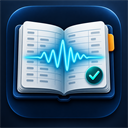
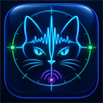
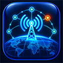
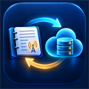
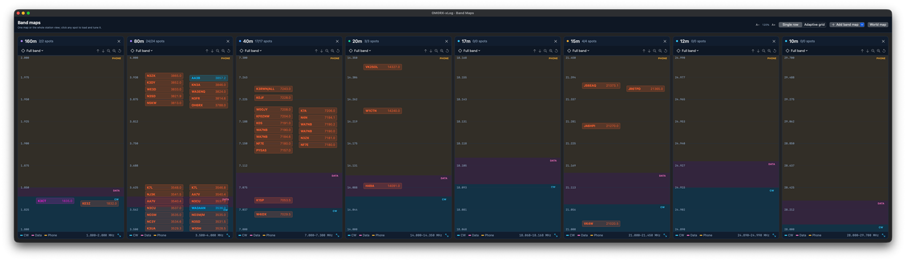
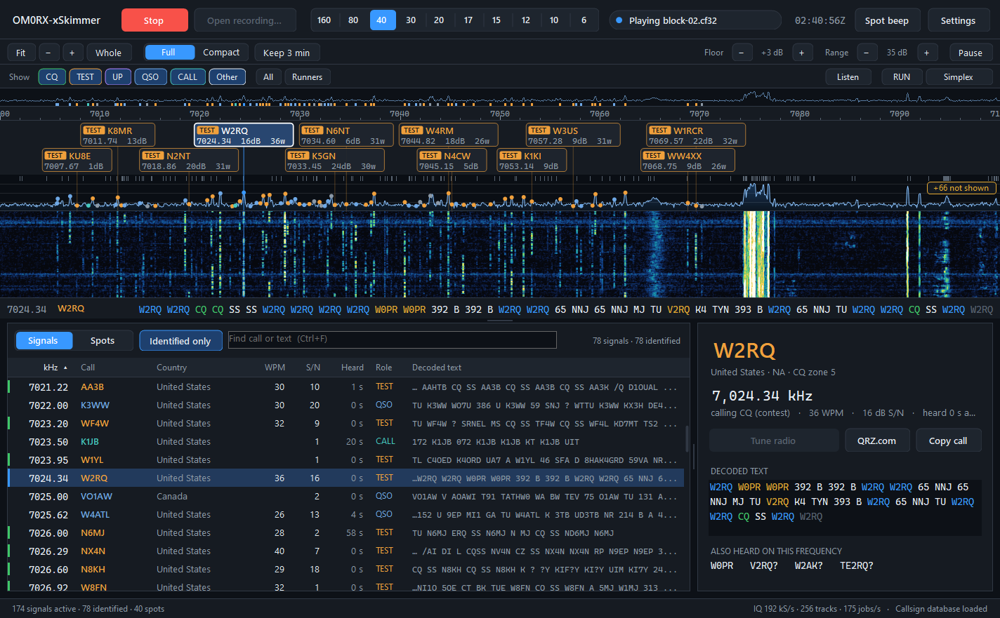
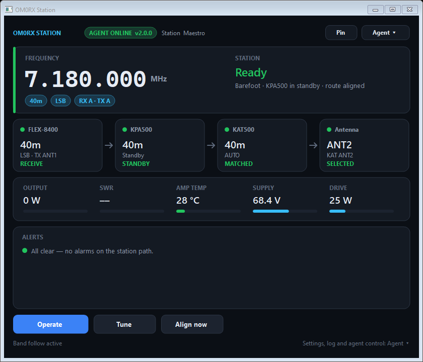

# OM0RX xSuite

**Amateur radio station software by Oliver Bross OM0RX** — a logbook, digital
modes, a CW skimmer and remote station control that work together, each also
usable on its own.

This is the home of every xSuite download. Each app is developed in its own
repository; finished builds, release notes and the matching source code are
published here.

<!-- xsuite:apps -->
| | App | What it does | Windows | macOS | Linux |
|---|---|---|:---:|:---:|:---:|
|  | [**OM0RX-xLog**](apps/xlog.md) | Local-first logbook with an Operator Desk, world and band maps, cluster, Wavelog sync, contesting and station control. | [**1.6.74**](https://github.com/oliverbross/OM0RX-xSuite/releases/download/xlog-v1.6.74/OM0RX-xLog-1.6.74-windows-x86_64-current-user-setup.exe) | [**1.6.77**](https://github.com/oliverbross/OM0RX-xSuite/releases/download/xlog-v1.6.77/OM0RX-xLog-1.6.77-macOS-arm64.zip) | [**1.6.0**](https://github.com/oliverbross/OM0RX-xSuite/releases/download/xlog-v1.6.0/OM0RX-xLog-1.6.0-Linux-x64.deb) |
|  | [**OM0RX-xNexus**](apps/xnexus.md) | Nexus (by KD9TAW) set up beside xLog: FT8/FT4 and ten more modes, with xLog's call and DXCC status in the roster. | [**1.25.0-xlog.17**](https://github.com/oliverbross/OM0RX-xSuite/releases/download/xnexus-v1.25.0-xlog.17/OM0RX-xNexus_1.25.0-xlog.17_x64-setup.exe) | soon | soon |
|  | [**OM0RX-xSkimmer**](apps/xskimmer.md) | CW skimmer for FlexRadio, TCI radios and SDRs (RTL-SDR, Airspy HF+, Hermes-Lite 2, MSi2500, SDRplay): decodes every CW signal with a neural decoder on several bands at once, tags who is calling whom, and shows xLog's worked/confirmed status (CS / DS) for every call. | [**1.4.1**](https://github.com/oliverbross/OM0RX-xSuite/releases/download/xskimmer-v1.4.1/OM0RX-xSkimmer-1.4.1-setup.exe) | — | — |
|  | [**OM0RX-xAgent**](apps/xagent.md) | Remote Station Agent: runs beside the radio, owns the FLEX-8400, KPA500 and KAT500, and serves the station to remote clients. | soon | — | — |
|  | [**OM0RX-xCat**](apps/xcat.md) | Mac FlexRadio CAT and RigCtlD bridge with SmartLink, station monitor, RUMlog spots and rotator control. | — | [**0.5.1**](https://github.com/oliverbross/OM0RX-xSuite/releases/download/xcat-v0.5.1/OM0RX-xCat-v0.5.1-macOS.zip) | — |
|  | [**OM0RX-xCluster**](apps/xcluster.md) | Mac DX-cluster client that classifies spots against your log and hands them to xLog or RUMlogNG. | — | [**0.1.6**](https://github.com/oliverbross/OM0RX-xSuite/releases/download/xcluster-v0.1.6/OM0RX-xCluster-0.1.6-macOS.zip) | — |
|  | [**OM0RX-xBridge**](apps/xbridge.md) | Mac two-way sync between RUMlogNG and Wavelog (API v2), without ever writing to the RUMlog database. | — | [**0.3.0**](https://github.com/oliverbross/OM0RX-xSuite/releases/download/xbridge-v0.3.0/OM0RX-xBridge-v0.3.0-macOS.zip) | — |
<!-- /xsuite:apps -->

Version numbers link straight to the recommended download for that system.
"—" means the app does not run there. Mac builds are for Apple Silicon.

## Which apps do I need?

| If you want to… | Install |
|---|---|
| Keep your log, chase DX, run contests | **xLog**: it is the centre of the suite and works fine alone |
| Work FT8/FT4 and other digital modes | **xNexus** next to xLog: every QSO lands in your xLog log |
| See every CW signal on the band, decoded | **xSkimmer**: its spots and decoded text show up in xLog |
| Operate your station remotely | **xAgent** on the Windows PC beside the radio, then connect xLog (or xCat on a Mac) to it |
| Keep using RUMlogNG on the Mac | **xCat**, **xCluster** and **xBridge** (see below) |

**About the Mac companions.** xCat, xCluster and xBridge are Mac-only apps that
grew up around RUMlogNG. Their features are moving into xLog, which runs on
Windows, macOS and Linux. They stay available and receive fixes, but new
features go into xLog.

## The apps

### OM0RX-xLog — logbook and operator desk

A local-first logbook: your contacts live on your own computer and it works
offline. Log at the Operator Desk with callsign intelligence, follow spots on a
world map and any number of band maps, sync with Wavelog, look up callsigns,
run contests, and control a local or remote station.
[More about xLog →](apps/xlog.md)

### OM0RX-xNexus — digital modes beside xLog

[Nexus](https://github.com/kd9taw/Nexus) by KD9TAW, built and set up to work
next to xLog: FT8/FT4 with WSJT-X parity and many more modes, plus xLog's call
and DXCC status colours in the Call Roster. Every logged contact is reported to
xLog. [More about xNexus →](apps/xnexus.md)

### OM0RX-xSkimmer — CW skimmer

Takes the wideband IQ from a FlexRadio, a TCI radio (SunSDR, ANAN,
AetherSDR) or an SDR (RTL-SDR, Airspy HF+, Hermes-Lite 2, several bands at once), finds and decodes every CW signal with a neural decoder, and tags
each station as CQ, TEST, UP, QSO or caller. It spots to your logger, a
cluster, the RBN or the radio's panadapter, has a RUN mode that shows who is
calling you, and lets you listen to any signal in the app.
[More about xSkimmer →](apps/xskimmer.md)

### OM0RX-xAgent — remote station agent

The Windows service that runs beside the radio. It is the only program that
talks to the FLEX-8400, KPA500 amplifier and KAT500 tuner, keeps band, antenna
and amplifier aligned, refuses to key on a fault, and serves the station
securely to xLog and xCat anywhere. [More about xAgent →](apps/xagent.md)

### Mac companions: xCat, xCluster, xBridge

- [**OM0RX-xCat**](apps/xcat.md): FlexRadio CAT and RigCtlD for RUMlogNG, with
  SmartLink, a station monitor, RUMlog spots on the panadapter and rotator control.
- [**OM0RX-xCluster**](apps/xcluster.md): DX-cluster client that classifies
  every spot against your log and hands it to xLog or RUMlogNG.
- [**OM0RX-xBridge**](apps/xbridge.md): two-way sync between RUMlogNG and Wavelog.

## Downloads, updates and verification

- Every release is a GitHub release in this repository, tagged
  `<app>-v<version>` (for example `xlog-v1.6.74`). The table above always points
  at the newest build for each system.
- Each release includes `SHA256SUMS`, a `PROVENANCE.json` naming the exact
  source commit, and the complete source code as a ZIP.
- [`suite.json`](suite.json) lists every app and release in a machine-readable
  form ([format](docs/MANIFEST.md)). The apps' update checks, and later the
  **xSuite Manager** (one installer that installs and updates the whole suite),
  read it.

## Licence

All xSuite apps are free software under the
[GNU GPL v3](https://www.gnu.org/licenses/gpl-3.0.html). xNexus is a derivative
of Nexus by KD9TAW and keeps its upstream attribution. FlexRadio, SmartSDR,
SmartLink, Elecraft, RUMlogNG, Wavelog and other names are trademarks of their
owners; this project is independent of them.

Problems or questions: [open an issue](https://github.com/oliverbross/OM0RX-xSuite/issues).
