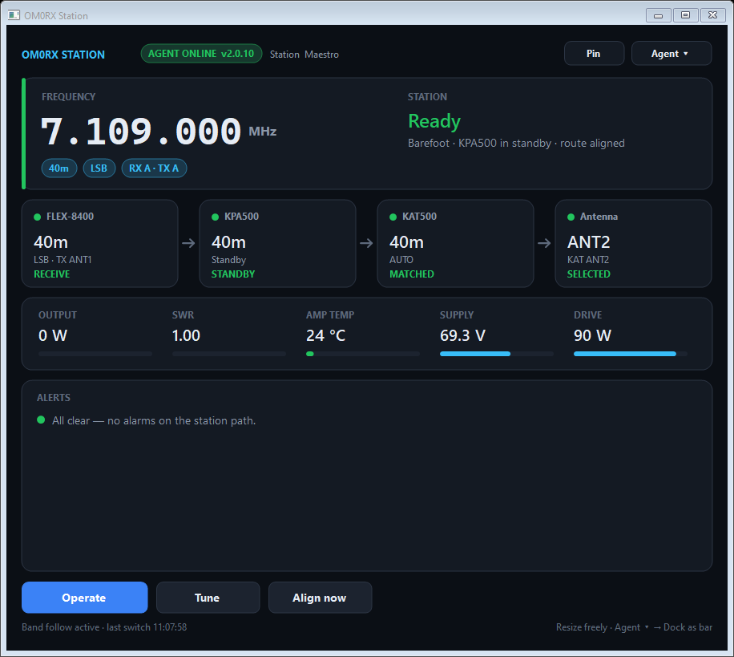
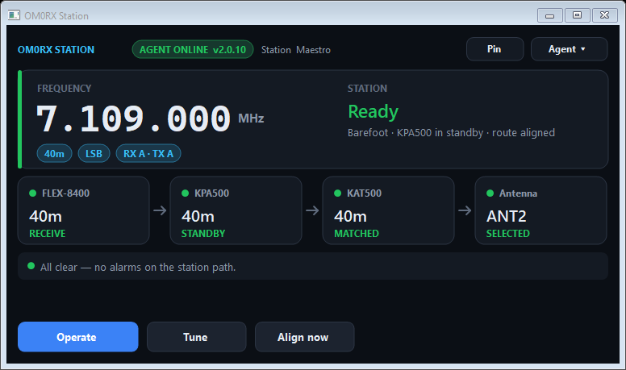
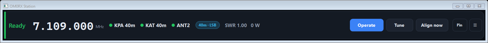

# OM0RX-xAgent — Remote Station Agent

**The Windows service that runs beside the radio.** It is the single program
that owns the FlexRadio FLEX-8400 connection and the Elecraft KPA500 amplifier
and KAT500 tuner serial ports. It keeps the whole station path aligned and
serves it securely to [xLog](xlog.md) and [xCat](xcat.md) wherever you are.



The console adapts to the window, down to a bar docked at the top of the screen:





## What it does

- **One owner for the hardware:** radio, amplifier and tuner are never
  fought over by several programs.
- **Band follow:** the KPA500 band and the KAT500 band, frequency and antenna
  follow the FLEX in receive, with the amplifier in standby, even while a fault
  is latched.
- **Safe keying:** OPERATE, TUNE and transmit require a fault-free, verified
  route, a connected key line and exact drive readback. Otherwise the
  amplifier stays in standby and the console explains why.
- **Remote access:** an authenticated HTTP and WebSocket API (protocol v1),
  published privately through Tailscale Serve, never on the open internet.
- **Station console:** a native Windows tray app showing frequency, the
  radio → amplifier → tuner → antenna chain, meters, alerts with guidance, and
  guarded actions.
- **Relays xSkimmer** to remote loggers: decoded CW text, and the N1MM+ spectrum
  feed, so xLog (1.6.91 and later) shows its Panadapter without any open port.
- **CW macros** from xLog are keyed by the FLEX, with a guarded route check first.
- **Command log:** every remote command with its result, error code and timing.
- **Better on a busy PC:** runs above normal priority, so amplifier and tuner
  readbacks are less likely to time out when other programs use all the CPU.

## Download and install

<!-- xsuite:downloads -->
- **Windows** — 2.0.10: [source ZIP](https://github.com/oliverbross/OM0RX-xSuite/releases/download/xagent-v2.0.10/OM0RX-xAgent-2.0.10-source.zip) 356 kB
<!-- /xsuite:downloads -->

xAgent ships as a source package for the station PC. Requirements: Windows
10/11, Python 3.11 or newer, the .NET 8 SDK (for the console), a FLEX-8400 on
the LAN, the KPA500/KAT500 on serial ports, and Tailscale for remote access.

1. Extract the ZIP to a permanent folder, for example `C:\OM0RX-xAgent`.
2. In PowerShell in that folder:
   ```powershell
   .\scripts\setup_remote_agent.ps1
   .\scripts\init_remote_agent.ps1 -Python .\.venv\Scripts\python.exe
   .\scripts\install_remote_agent_startup.ps1 -Python .\.venv\Scripts\python.exe
   .\scripts\install_remote_agent_tray_startup.ps1 -Python .\.venv\Scripts\python.exe
   ```
3. Open **OM0RX Station** from the Start menu to review settings and copy the
   access token into your clients.

**Panadapter in a remote xLog:** in xSkimmer on the station PC, enable
Settings → N1MM+ spectrum with host `127.0.0.1` and port `13064`.

**Restarting:** use **Restart** in the tray with the radio in receive. Do not stop
the scheduled task directly, because that skips the safe shutdown (carrier off,
MOX off, KPA500 in standby).

The README inside the package covers configuration, Tailscale and recovery in
detail. A one-click installer will follow with the xSuite Manager.

## Release history

<!-- xsuite:history -->
| Version | Date | Platforms | Notes | Source |
|---|---|---|---|---|
| 2.0.10 | 2026-11-23 | Windows | [release notes](https://github.com/oliverbross/OM0RX-xSuite/releases/tag/xagent-v2.0.10) | [source ZIP](https://github.com/oliverbross/OM0RX-xSuite/releases/download/xagent-v2.0.10/OM0RX-xAgent-2.0.10-source.zip) `0f4dcc3d36` |
<!-- /xsuite:history -->
