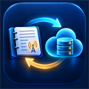

#  OM0RX-xBridge

**Mac companion app.** Keeps RUMlogNG and [Wavelog](https://www.wavelog.org/)
in sync in both directions, using Wavelog API v2. It reads your `.rlog`
logbook read-only, imports new contacts through RUMlogNG's own ADIF interface,
and applies remote edits through RUMlog's peer stream. It never writes to the
RUMlog database directly.

> xBridge is a **companion** app for RUMlogNG users. [xLog](xlog.md) has its
> own Wavelog sync on every system.

## What it does

- Two-way sync of new contacts and edits: time, frequency, band, mode,
  reports, grid, name, QTH, zones, IOTA, QSL route, power, satellites and more.
- Restart-safe initial bootstrap from Wavelog, checkpointed page by page.
- Automatic sync every few minutes plus a Sync Now button; full reconciliation
  at least every five minutes.
- Ambiguous concurrent edits and deletions are held and reported, never
  guessed.
- The Wavelog API token is kept in the macOS Keychain, never in preferences or
  logs.

## Download

<!-- xsuite:downloads -->
- **macOS** — 0.3.0: [ZIP](https://github.com/oliverbross/OM0RX-xSuite/releases/download/xbridge-v0.3.0/OM0RX-xBridge-v0.3.0-macOS.zip) 3 MB
<!-- /xsuite:downloads -->

Requires macOS 13 or later on Apple Silicon, and RUMlogNG with "Listen to other
RUMlog instances" enabled. Unzip and move OM0RX-xBridge to Applications.

## Release history

<!-- xsuite:history -->
| Version | Date | Platforms | Notes | Source |
|---|---|---|---|---|
| 0.3.0 | 2026-10-11 | macOS | [release notes](https://github.com/oliverbross/OM0RX-xSuite/releases/tag/xbridge-v0.3.0) | [source ZIP](https://github.com/oliverbross/OM0RX-xSuite/releases/download/xbridge-v0.3.0/OM0RX-xBridge-0.3.0-source.zip) `1b55315663` |
<!-- /xsuite:history -->
