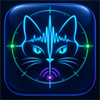
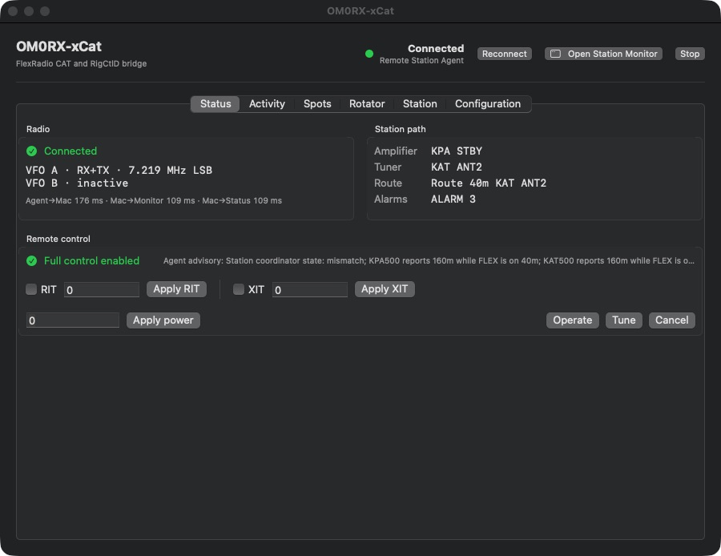

#  OM0RX-xCat

**Mac companion app.** A native macOS bridge between RUMlogNG (or another CAT
client) and a FlexRadio. It provides loopback-only Kenwood TS-480 CAT and
Hamlib RigCtlD services, native SmartLink remote access, and a client for the
[Remote Station Agent](xagent.md).

> xCat is a **companion** app: it receives fixes, while its features move into
> [xLog](xlog.md), which runs on Windows, macOS and Linux.

## What it does

- Native SmartLink sign-in, broker discovery, WAN TLS validation and radio
  certificate pinning; tokens are kept in the macOS Keychain.
- Connects to the Windows Remote Station Agent over authenticated HTTPS and
  WebSocket.
- A menu-bar station widget and an undockable station monitor: VFOs, RX/TX,
  power, SWR, drive, KPA500/KAT500 telemetry, route and alarms.
- A RUMlogNG UDP spot bridge with separate Logbook and Contest rules, colours
  and lifetimes, putting spots on the FLEX panadapter without ever keying.
- DCU-1 rotator control with a compass, a great-circle map, per-band offsets
  and RUMlog targets.

## Download

<!-- xsuite:downloads -->
- **macOS** — 0.5.1: [ZIP](https://github.com/oliverbross/OM0RX-xSuite/releases/download/xcat-v0.5.1/OM0RX-xCat-v0.5.1-macOS.zip) 3 MB
<!-- /xsuite:downloads -->

Requires macOS 14 or later on Apple Silicon. Unzip and move OM0RX-xCat to
Applications.

## Release history

<!-- xsuite:history -->
| Version | Date | Platforms | Notes | Source |
|---|---|---|---|---|
| 0.5.1 | 2026-10-11 | macOS | [release notes](https://github.com/oliverbross/OM0RX-xSuite/releases/tag/xcat-v0.5.1) | [source ZIP](https://github.com/oliverbross/OM0RX-xSuite/releases/download/xcat-v0.5.1/OM0RX-xCat-0.5.1-source.zip) `d10e82c626` |
<!-- /xsuite:history -->
