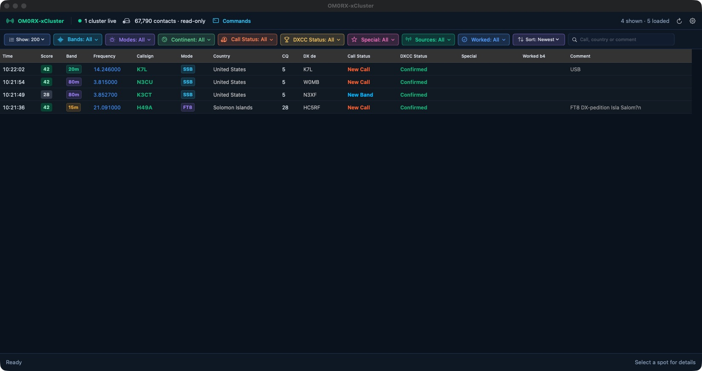

#  OM0RX-xCluster

**Mac companion app.** A native macOS DX-cluster client. It connects to one or
more clusters, classifies every live spot against your OM0RX-xLog or RUMlogNG
logbook, shows the full previous-QSO evidence, and hands a selected spot to xLog
or RUMlogNG for tuning.

> xCluster is a **companion** app: its cluster table, filters and
> classification are already built into [xLog](xlog.md) on every system, and it
> receives fixes only.

## What it does

- Several auto-reconnecting telnet clusters at once, with a built-in command
  console. RBN/Skimmer spots are on by default.
- A dense spot table: call, frequency, mode, country, CQ zone, call and DXCC
  status, special tags (POTA, SOTA, IOTA, WWFF, castles…), worked-before date,
  score and comment.
- One-row, colour-coded multi-select filters for band, mode, continent,
  status, specials, source and worked-before.
- Read-only access to the xLog database or a RUMlog `.rlog` file: xCluster
  never writes to either.
- A previous-QSO sheet with LoTW status and a country band/mode matrix.
- One-click handoff to xLog, including the award references.

## Download

<!-- xsuite:downloads -->
- **macOS** — 0.1.6: [ZIP](https://github.com/oliverbross/OM0RX-xSuite/releases/download/xcluster-v0.1.6/OM0RX-xCluster-0.1.6-macOS.zip) 3 MB
<!-- /xsuite:downloads -->

Requires macOS 13 or later on Apple Silicon. Unzip and move OM0RX-xCluster to
Applications.

## Release history

<!-- xsuite:history -->
| Version | Date | Platforms | Notes | Source |
|---|---|---|---|---|
| 0.1.6 | 2026-10-11 | macOS | [release notes](https://github.com/oliverbross/OM0RX-xSuite/releases/tag/xcluster-v0.1.6) | [source ZIP](https://github.com/oliverbross/OM0RX-xSuite/releases/download/xcluster-v0.1.6/OM0RX-xCluster-0.1.6-source.zip) `776b7b04ff` |
<!-- /xsuite:history -->
