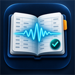
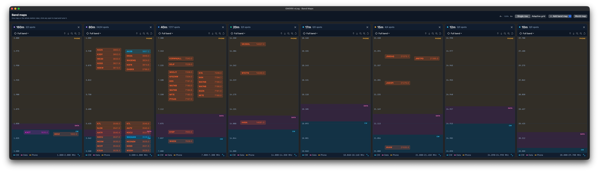
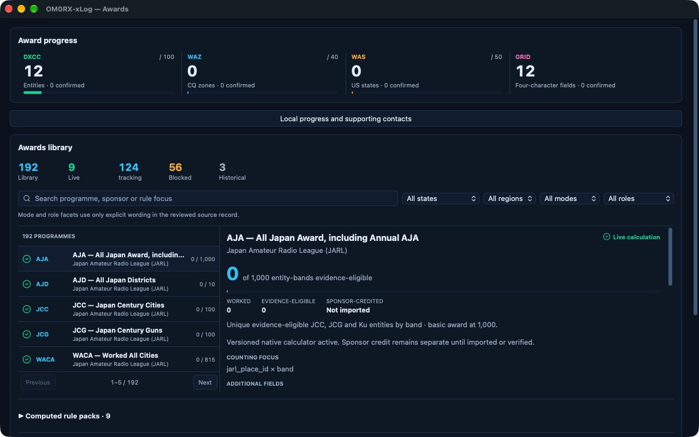

#  OM0RX-xLog

**Local-first logbook and operator desk for Windows, macOS and Linux.** Your
contacts live in a SQLite logbook on your own computer, and xLog works fully
offline. Wavelog, online lookups, the DX cluster and station control are
optional extras you switch on when you want them.

## What it does

- **Operator Desk:** a compact three-row QSO entry with callsign intelligence
  (worked and confirmed by band, last contact, country and grid), a world map
  with the great-circle path, and live band maps, all on one screen.
- **Logbook:** search, edit, saved filters, duplicate review, ADIF import and
  export, and backups you can review before restoring.
- **DX cluster and RBN:** spots are coloured by call and DXCC status against
  your own log and shown on the world map and any number of band maps. Click a
  spot to tune the radio and prefill the QSO.
- **Wavelog sync** (API v2), with pending operations and conflicting edits
  shown for review instead of being guessed.
- **Contesting:** a contest operating mode with exchanges, scoring and
  exports per contest definition.
- **Awards:** local progress for DXCC, WAZ, WAS, grids and a library of nearly
  200 programmes.
- **Station control:** local radios and rotators through Hamlib, or a full
  remote station through [OM0RX-xAgent](xagent.md): frequency, mode, amplifier,
  tuner, rotor, and SP/LP paths.
- **Works with the rest of the suite:** FT8/FT4 contacts from
  [xNexus](xnexus.md) land in the log, and [xSkimmer](xskimmer.md) spots and
  decoded CW text appear on the desk.

## Download

<!-- xsuite:downloads -->
- **Windows** — 1.6.74: [installer (current user)](https://github.com/oliverbross/OM0RX-xSuite/releases/download/xlog-v1.6.74/OM0RX-xLog-1.6.74-windows-x86_64-current-user-setup.exe) 61 MB · [ZIP](https://github.com/oliverbross/OM0RX-xSuite/releases/download/xlog-v1.6.74/OM0RX-xLog-1.6.74-windows-x86_64.zip) 88 MB · [installer (all users)](https://github.com/oliverbross/OM0RX-xSuite/releases/download/xlog-v1.6.74/OM0RX-xLog-1.6.74-windows-x86_64-all-users-setup.exe) 61 MB
- **macOS** — 1.6.77: [ZIP](https://github.com/oliverbross/OM0RX-xSuite/releases/download/xlog-v1.6.77/OM0RX-xLog-1.6.77-macOS-arm64.zip) 59 MB
- **Linux** — 1.6.0: [.deb](https://github.com/oliverbross/OM0RX-xSuite/releases/download/xlog-v1.6.0/OM0RX-xLog-1.6.0-Linux-x64.deb) 62 MB · [.tar.gz](https://github.com/oliverbross/OM0RX-xSuite/releases/download/xlog-v1.6.0/OM0RX-xLog-1.6.0-Linux-x64.tar.gz) 82 MB
<!-- /xsuite:downloads -->

| System | Requirements | Install |
|---|---|---|
| Windows | Windows 10/11 x64; WebView2 (the installers fetch it when online) | Run the **current-user** installer (no admin rights) or the all-users one. The portable ZIP must be extracted whole. |
| macOS | macOS 14 or later, Apple Silicon | Open the DMG and drag OM0RX-xLog to Applications. Signed and notarized. |
| Linux | Ubuntu 24.04 amd64 (other distributions untested); Python 3.12 | `sudo apt install ./OM0RX-xLog-<version>-Linux-x64.deb` |

Windows builds are not code-signed yet, so Windows may show a SmartScreen
warning. Check the file against `SHA256SUMS` on the release page.

**Upgrading:** back up your workspace (Settings → Backup), quit xLog normally,
then install the new version over the old one. Your logbook and settings stay
in your workspace and are not touched by the installer.

## Release history

<!-- xsuite:history -->
| Version | Date | Platforms | Notes | Source |
|---|---|---|---|---|
| 1.6.77 | 2026-11-21 | macOS | [release notes](https://github.com/oliverbross/OM0RX-xSuite/releases/tag/xlog-v1.6.77) | [source ZIP](https://github.com/oliverbross/OM0RX-xSuite/releases/download/xlog-v1.6.77/OM0RX-xLog-1.6.77-source.zip) `a5bbef1e62` |
| 1.6.74 | 2026-11-19 | Windows | [release notes](https://github.com/oliverbross/OM0RX-xSuite/releases/tag/xlog-v1.6.74) | [source ZIP](https://github.com/oliverbross/OM0RX-xSuite/releases/download/xlog-v1.6.74/OM0RX-xLog-1.6.74-source.zip) `3a9abd5b00` |
| 1.6.0 | 2026-11-11 | Windows, macOS, Linux | [release notes](https://github.com/oliverbross/OM0RX-xSuite/releases/tag/xlog-v1.6.0) | [source ZIP](https://github.com/oliverbross/OM0RX-xSuite/releases/download/xlog-v1.6.0/OM0RX-xLog-1.6.0-source.tar.gz) `6874a161c6` |
<!-- /xsuite:history -->
