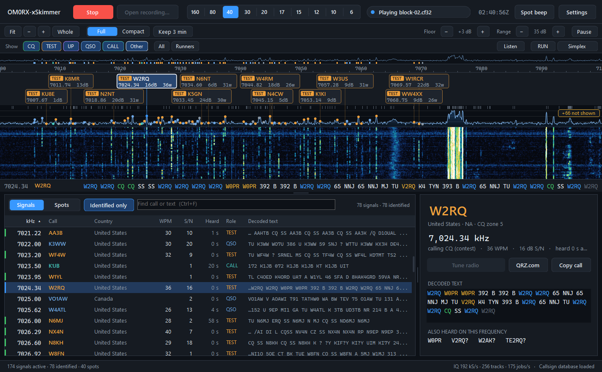
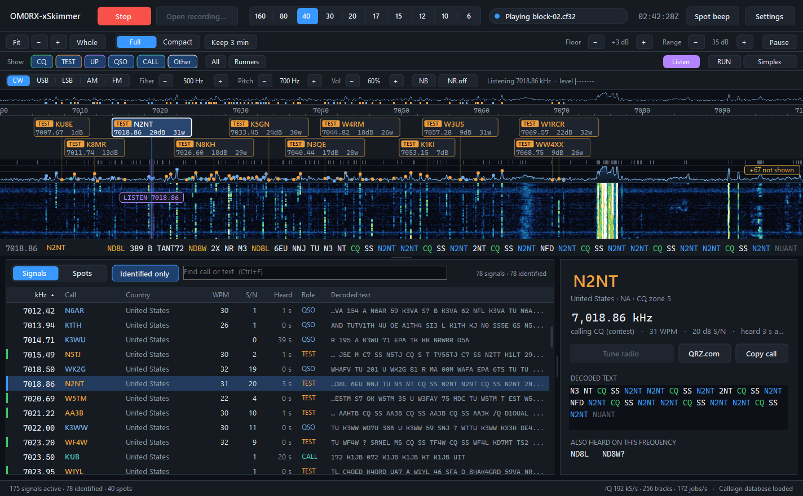
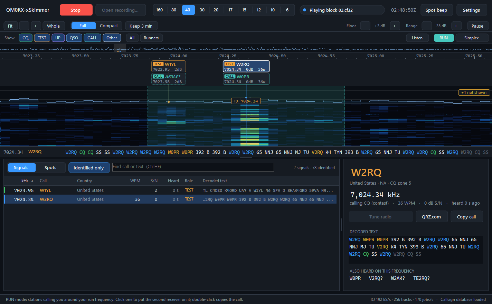

# OM0RX-xSkimmer

**A CW skimmer for FlexRadio and TCI radios.** It takes the radio's wideband
IQ, finds every CW signal, decodes each one with the DeepCW neural model, works
out who is calling CQ, and shows it all on a band map, a signal list and a spot
list.

## What it does

- **Every CW signal, decoded.** The DeepCW neural model copies each signal in
  the passband. A band map shows the whole span: an overview strip, station
  tags with call, frequency, S/N and speed, a spectrum trace with your RX
  marker, and the waterfall. A live decoder strip under the map shows the copy
  of the signal you follow as it arrives.
- **Who is doing what.** Each station is tagged from what it sends: **CQ**,
  **TEST** (contest CQ), **UP** (split), **QSO**, **CALL** (answering someone)
  or beacon. One click on the Show bar filters the map and the lists, for
  example to runners only. Calls read only once are shown dashed with a `?`.
- **RUN mode for contests.** When you are calling CQ, xSkimmer shows only the
  stations calling you around your transmit frequency, decodes them first, and
  puts each call heard there on its own tag. Click a caller to put the second
  receiver (TCI VFO B, FLEX second slice) on it; double-click to send the call
  to [xLog](xlog.md)'s entry field.
- **Listen in the app.** Click any signal and hear it through a sound card of
  your choice: CW, USB, LSB, AM or FM, with filter, pitch, volume, noise
  blanker and noise reduction. The radio stays where it is.
- **FlexRadio without using a receiver slot:** binds to SmartSDR or Maestro as
  an API client and skims that client's own panadapter through DAX IQ.
- **TCI radios:** SunSDR (ExpertSDR), ANAN (Thetis) and any radio behind
  AetherSDR's TCI server.
- **Spots everywhere:** a local telnet server for your logger, an optional
  HEARD port, a remote DX cluster, the radio's own panadapter, and a Skimmer
  Server compatible port for the **RBN Aggregator** to feed the Reverse Beacon
  Network. Optional **RBN Reference** checks calls against live RBN spots to
  drop busted ones.
- **N1MM Logger+:** the skimmer's spectrum appears in N1MM+'s Spectrum Display.
- **Verification and health:** SDC-style spot verification against MASTER.SCP,
  a Diagnostics page (IQ rate, decoder load, ports), and callsign data that
  downloads and refreshes itself.

| | |
|---|---|
|  |  |
| Listening in CW on N2NT, with its copy in the decoder strip | RUN mode: W0PR calling W2RQ, zoomed on the run window |

## Download

<!-- xsuite:downloads -->
- **Windows** — 0.9.0: [installer](https://github.com/oliverbross/OM0RX-xSuite/releases/download/xskimmer-v0.9.0/OM0RX-xSkimmer-0.9.0-setup.exe) 57 MB
<!-- /xsuite:downloads -->

Requires Windows 10/11 x64 and a FlexRadio (SmartSDR or Maestro running) or a
TCI radio. The installer upgrades earlier OM0RX Skimmer versions in place and
keeps your settings.

## Release history

<!-- xsuite:history -->
| Version | Date | Platforms | Notes | Source |
|---|---|---|---|---|
| 0.9.0 | 2026-11-21 | Windows | [release notes](https://github.com/oliverbross/OM0RX-xSuite/releases/tag/xskimmer-v0.9.0) | [source ZIP](https://github.com/oliverbross/OM0RX-xSuite/releases/download/xskimmer-v0.9.0/OM0RX-xSkimmer-0.9.0-source.zip) `21ceb62fe7` |
<!-- /xsuite:history -->
